

<picture>
  <source media="(prefers-color-scheme: dark)" srcset="docs/assets/mobilecarconnect-mark-dark.svg">
  <source media="(prefers-color-scheme: light)" srcset="docs/assets/mobilecarconnect-mark-light.svg">
  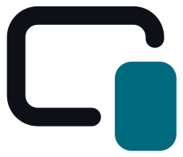
</picture>

# MobileCarConnect

**CarPlay e Android Auto num app só, para qualquer central multimídia ou tablet Android.**

[-3DDC84?logo=android&logoColor=white)](#requisitos)

[**Baixar**](https://github.com/F-e-n-y-x/CarLink/releases/latest) ·
[Instalar](#instalar) · [Guia do usuário](docs/USER_GUIDE.md) ·
[Solução de problemas](docs/TROUBLESHOOTING.md) · [Documentação](docs/README.md)

[English](README.md) · **Português**

Instale o MobileCarConnect numa central multimídia Android, ou num tablet ou celular Android usado
como tela do carro. Plugue ou conecte seu celular: um **iPhone abre o CarPlay** e um **celular
Android abre o Android Auto**, por cabo (USB) ou sem fio. O MobileCarConnect descobre sozinho qual é
o celular; você não precisa escolher nada.

O MobileCarConnect é genérico: serve para qualquer central ou tablet Android, não para uma marca de
carro. Ele junta dois motores de código aberto, importados com todo o histórico: **DiPlay**
(CarPlay) e **DiAuto** (Android Auto), ambos feitos para as centrais BYD DiLink. Os recursos só da
BYD ficam desligados, a menos que você escolha BYD como marca do carro.

<table>
  <tr>
    <td width="50%"><a href="docs/screenshots/home/home_ready-iphone-usual_tablet_dark.webp">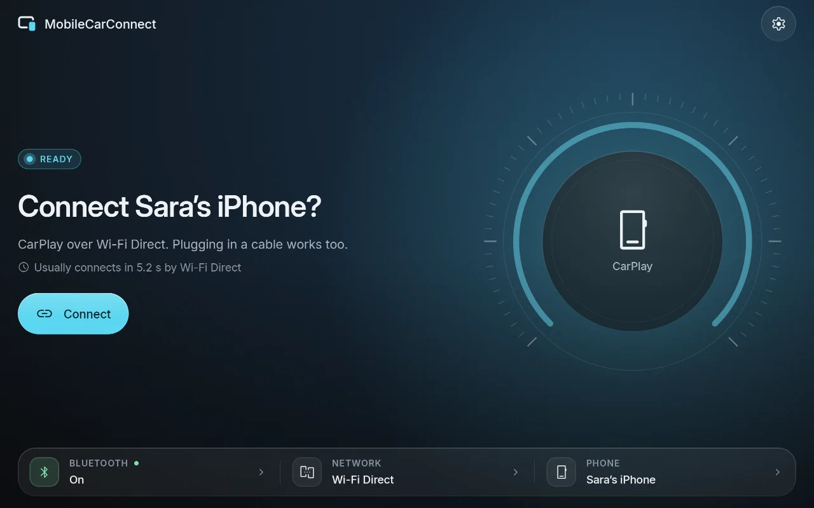</a> Tela inicial: um status, uma ação</td>
    <td width="50%"><a href="docs/screenshots/home/home_connecting-carplay-usb_tablet_dark.webp">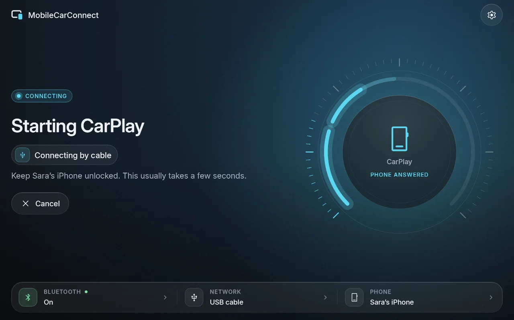</a> Conectando, passo a passo</td>
  </tr>
  <tr>
    <td><a href="docs/screenshots/switcher/switcher_panel_tablet_dark.webp">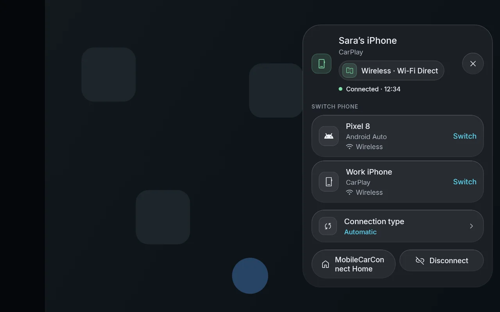</a> Botão flutuante sobre o CarPlay e o Android Auto</td>
    <td><a href="docs/screenshots/home/home_connected-android-auto-usb_tablet_dark.webp">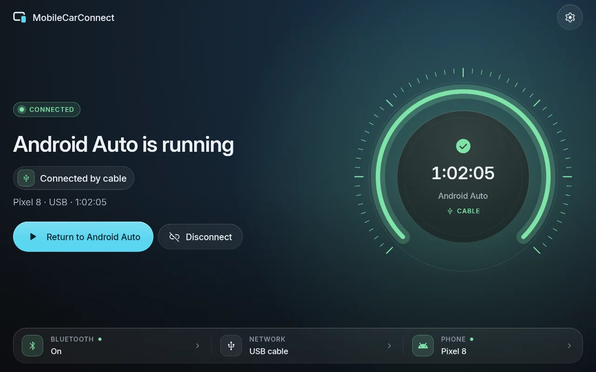</a> Uma sessão em andamento</td>
  </tr>
  <tr>
    <td><a href="docs/screenshots/setup/setup_car_tablet_dark.webp">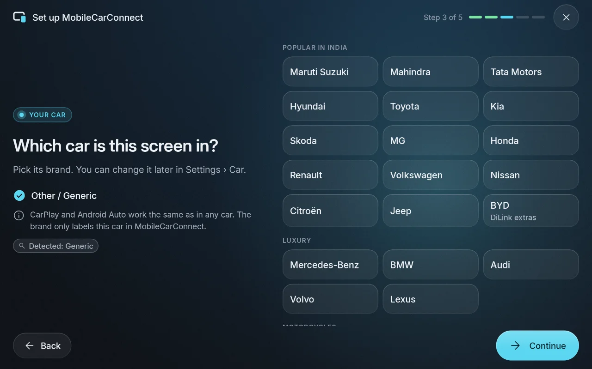</a> Configuração inicial: marca do carro</td>
    <td> Configurações (tema claro)</td>
  </tr>
  <tr>
    <td><a href="docs/screenshots/update/update_available_tablet_dark.webp">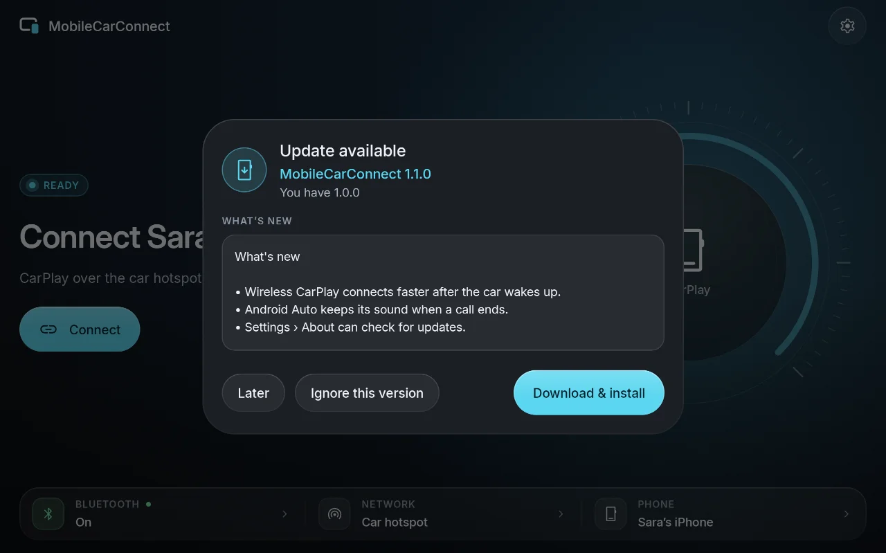</a> Atualização dentro do app (notas de exemplo)</td>
    <td><a href="docs/screenshots/diagnostics/diagnostics_phones-card_tablet_dark.webp">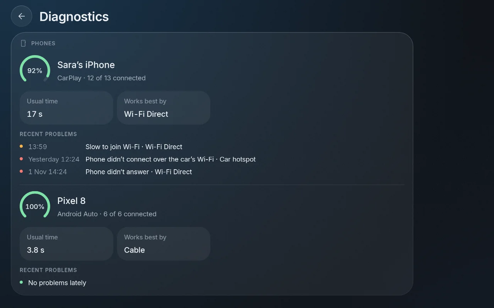</a> Diagnóstico: a conexão de cada celular</td>
  </tr>
  <tr>
    <td><a href="docs/screenshots/home/home_ready-iphone-usual_car-landscape_dark.webp">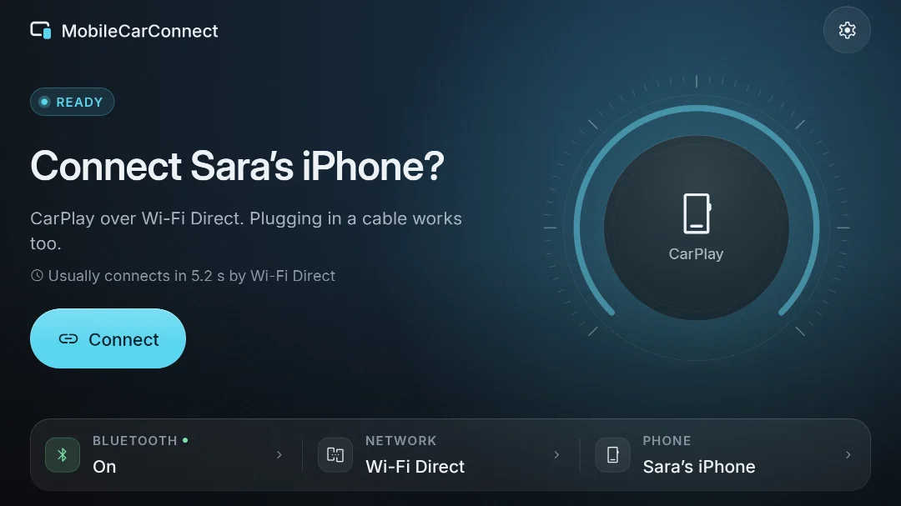</a> Numa tela de carro: botões e textos maiores</td>
    <td><a href="docs/screenshots/home/home_connected-carplay_headunit-1024x600_dark.webp">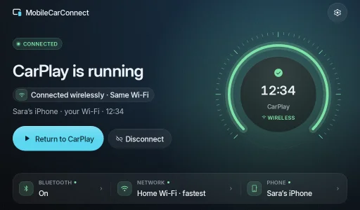</a> Numa central de 1024×600</td>
  </tr>
</table>

Acima, capturas no tamanho de tablet; na última linha, tamanhos de tela de carro. Elas são geradas
a partir das telas do app com dados de exemplo, não capturadas de um celular. Todas as telas e
estados, em todos os tamanhos: [galeria de capturas](docs/screenshots/README.md) (em inglês). O app
está em inglês.

## Num carro de verdade

Um jeito simples de ter uma tela grande de CarPlay num carro cuja central não tem: prender um
tablet Android por cima da tela original com dois suportes magnéticos e rodar o MobileCarConnect no
tablet.

<table>
  <tr>
    <td width="50%"><a href="docs/assets/real-world/stock-screen-with-magnetic-holders.jpg">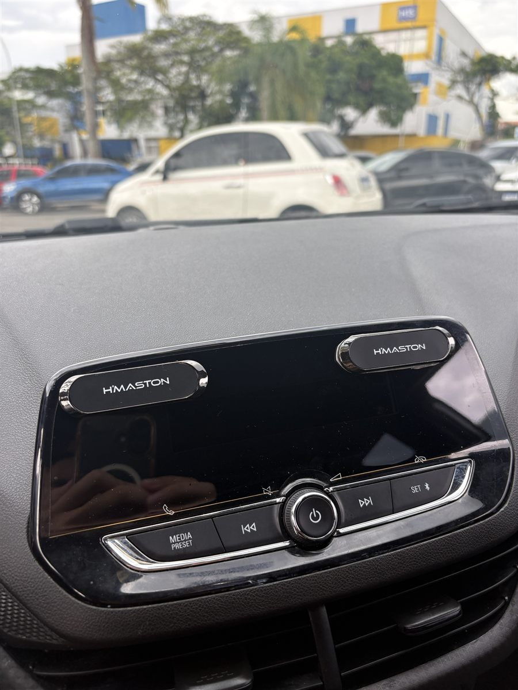</a> Antes: dois suportes magnéticos na tela original</td>
    <td width="50%"><a href="docs/assets/real-world/tablet-running-carplay.jpg">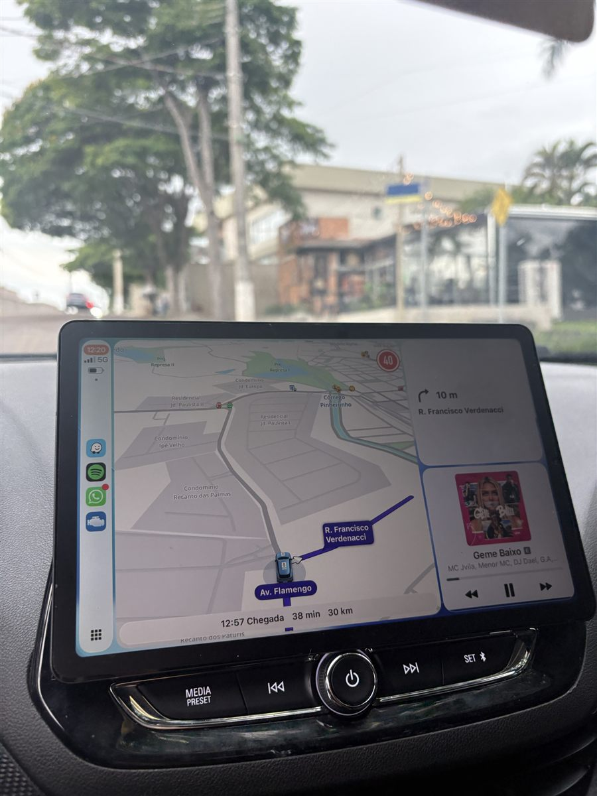</a> Depois: o tablet rodando o CarPlay com Waze e Spotify</td>
  </tr>
</table>

1. Cole os dois suportes magnéticos na tela original, com a mesma distância da largura do tablet.
2. Cole as chapinhas de metal do kit atrás do tablet (ou da capa) nos mesmos pontos e encaixe o
   tablet nos suportes. Os botões do carro, embaixo, continuam ao alcance.
3. Instale o MobileCarConnect no tablet, pareie o celular uma vez pelas configurações de Bluetooth
   dele e conecte. Se você só usa iPhone, ligue **Settings › Connection › CarPlay only** para
   economizar memória.

Confira se o tablet não cobre um airbag, uma saída de ar que você usa ou a visão da rua.

**Peças usadas nesta montagem** (Mercado Livre):

- [Tablet Samsung Galaxy Tab S10 Lite 5G (8 GB de RAM, 256 GB)](https://meli.la/2PcTBAV)
- [Kit com 2 suportes magnéticos para painel](https://meli.la/2KhYqVd)

São links de afiliado: comprando por eles você apoia o autor desta montagem.

## Recursos

- **Detecção automática.** iPhone → CarPlay, celular Android → Android Auto, pelo dispositivo USB
  ou pelos serviços Bluetooth do celular. Nada para escolher.
- **USB e sem fio.** O sem fio usa Wi-Fi Direct por padrão (sem precisar de roteador nem de
  hotspot); o hotspot do próprio carro e a mesma rede Wi-Fi são opções.
- **Plugar e usar.** Ao plugar, já começa; o último celular reconecta sozinho quando o
  MobileCarConnect vem para a frente.
- **Trocar de celular.** Um segundo celular pergunta "Switch to &lt;celular&gt;?" em vez de tomar
  o lugar, e um botão flutuante sobre o CarPlay e o Android Auto troca de celular ou volta para o
  MobileCarConnect.
- **Simples por padrão, completo quando precisa.** A tela inicial mostra um status e uma ação, com
  correção em um toque quando algo dá errado; **Show advanced** nas Configurações tem todas as
  opções dos motores.
- **Qualquer central ou tablet Android**, com layouts de carro e de celular/tablet, escuro e claro.
- **Modo leve.** Desenho mais leve em centrais com pouca memória ou processador fraco.
- **Atualizações dentro do app** pelo GitHub Releases, verificadas antes de instalar.
- **Marcas de carro.** Escolha a marca (marcas populares na Índia, marcas de luxo ou Other); só a
  BYD muda o comportamento, ligando os extras da DiLink.
- **Diagnóstico** com verificações do aparelho e um registro de conexão para compartilhar.

## Requisitos

- **A tela:** Android 7.1 ou mais novo em ARM (`arm64-v8a` ou `armeabi-v7a`): uma central
  multimídia, um tablet ou um celular usado como tela do carro. Instale o MobileCarConnect nela,
  não no seu celular.
- **iPhone (CarPlay)** ou **celular Android (Android Auto)**, com cabo USB, ou com Bluetooth e
  Wi-Fi ligados para o sem fio. O sem fio precisa de um pareamento, feito a partir do celular.

## Instalar

1. Abra a página de [Releases](https://github.com/F-e-n-y-x/CarLink/releases/latest) na tela (ou
   num computador e depois copie o arquivo por pendrive ou cabo).
2. Baixe o `MobileCarConnect-X.Y.Z.apk`. Para conferir o arquivo, compare o SHA-256 dele com o
   arquivo `MobileCarConnect-X.Y.Z.apk.sha256` da mesma versão
   (`sha256sum -c MobileCarConnect-X.Y.Z.apk.sha256`).
3. Abra o APK. O Android pede para permitir instalar apps pelo navegador ou gerenciador de
   arquivos que você usou ("Instalar apps desconhecidos" › **Permitir desta fonte**). Permita,
   volte e toque em **Instalar**.
4. Abra o MobileCarConnect e siga a configuração inicial.

**Adicionar ao Obtainium.** O [Obtainium](https://github.com/ImranR98/Obtainium) acompanha as
versões do MobileCarConnect no GitHub e instala cada nova: no Obtainium toque em **Add app** e cole
`https://github.com/F-e-n-y-x/CarLink`, ou abra
`obtainium://add/https://github.com/F-e-n-y-x/CarLink` num aparelho que tenha o Obtainium
([deep links](https://wiki.obtainium.imranr.dev/deep_links/)).

Cada [página de versão](https://github.com/F-e-n-y-x/CarLink/releases) repete esses passos com o
SHA-256 do APK e o certificado de assinatura.

O pacote da versão é `com.mobilecarconnect.app`. Ele é assinado com a chave de release própria do
MobileCarConnect (SHA-256 do certificado
`03:74:68:CA:5B:EB:70:EA:5F:68:54:33:29:B0:33:68:24:7D:FB:39:3D:3F:62:6A:6B:47:2D:10:E5:65:7D:21`;
como conferir com o `apksigner`: [guia do usuário](docs/USER_GUIDE.md#install)). Um APK assinado
com outra chave não é uma versão oficial e não pode atualizá-la.

## Configuração inicial

1. **Permitir acesso.** O MobileCarConnect pede o que precisa (Bluetooth, dispositivos Wi-Fi
   próximos, localização, microfone, notificações, sobrepor outros apps) com um único
   **Allow all**.
2. **Escolher o carro.** Escolha a marca, ou Other. Só a BYD muda alguma coisa.
3. **Parear pelo celular.** No celular, abra as configurações de Bluetooth e toque no nome desta
   tela. Um tablet não consegue iniciar sozinho o lado "kit do carro" do pareamento, então o
   pareamento sempre começa no celular. Por cabo funciona sem parear.
4. **Conectar.** Toque em **Connect** na tela inicial (ou plugue o cabo). No celular, aceite "Usar
   o CarPlay" ou o aviso do Android Auto na primeira vez. Deixe o celular desbloqueado na primeira
   conexão.

Detalhes: [guia do usuário › First-time setup](docs/USER_GUIDE.md#first-time-setup).

## Atualizações

O MobileCarConnect procura novas versões neste repositório no máximo **a cada 6 horas**, só com a
tela dele aberta e **sem nenhum celular conectando ou conectado**, e pergunta antes de baixar. Antes
de instalar, confere o SHA-256, o pacote, a versão e a chave de assinatura do download, e apaga o
arquivo se alguma verificação falhar. **Settings › About** tem **Check for updates** e desliga as
verificações automáticas. Só a versão oficial se atualiza sozinha; o único dado enviado é o pedido
à API pública do GitHub. Detalhes: [guia do usuário › Updates](docs/USER_GUIDE.md#updates).

## O que funciona e o que foi testado

O que o MobileCarConnect suporta:

| | Por USB | Sem fio |
|---|---|---|
| **CarPlay** (iPhone) | sim | sim: Wi-Fi Direct (padrão), hotspot do próprio carro ou a mesma rede Wi-Fi (opcional) |
| **Android Auto** (celular Android) | sim | sim: Wi-Fi Direct (padrão) ou a mesma rede Wi-Fi (opcional) |

Comprovado num aparelho real, por enquanto um: um Redmi Pad Pro 5G (Android 16) com um iPhone e um
Samsung Galaxy S25 Ultra, em 09/10/2026:

- CarPlay por USB (cerca de 3,4 s do plugue até a imagem), Android Auto por USB (cerca de 3,8 s),
  Android Auto por Wi-Fi Direct (cerca de 5 s) e CarPlay por Wi-Fi Direct (cerca de 16-20 s, quase
  tudo chamando o iPhone pelo Bluetooth), e Android Auto pela mesma rede Wi-Fi;
- CarPlay pela mesma rede Wi-Fi falhou naquele roteador (ele não repassa mDNS entre os aparelhos;
  veja os [limites conhecidos](docs/USER_GUIDE.md#known-limits)).

**Ainda não testado:** o caminho pelo hotspot do carro (o tablet não tinha carro para entrar),
outras centrais e tablets, e Android 7.1-9.
**A versão 1.0.0 assinada ainda não foi testada num aparelho**; os resultados acima vêm de versões
de desenvolvimento do mesmo código. Este README vai avisar quando for. Relatos de outras centrais
são muito bem-vindos.

## Perguntas frequentes

**Qual celular abre o quê?** Um iPhone sempre abre o CarPlay e um celular Android, o Android Auto.
O MobileCarConnect decide pelo ID de fabricante do USB ou pelos serviços Bluetooth do celular, e
guarda isso.

**Preciso de roteador ou do hotspot do carro para o sem fio?** Não. O Wi-Fi Direct liga o celular
e a tela diretamente. Durante o Android Auto sem fio, os apps do celular usam os dados móveis,
porque essa ligação não tem internet.

**Por que meu celular não conecta sozinho quando entro no carro?** Um tablet não é um kit
Bluetooth de carro, então o celular nunca se conecta a ele por conta própria; o MobileCarConnect
chama o último celular quando a tela inicial dele vem para a frente. Uma central de carro com
função viva-voz é reconectada pelo próprio celular.

**A tela inicial diz "Your iPhone couldn't reach this screen".** Seu roteador Wi-Fi bloqueia a
ligação de que o CarPlay precisa. Toque em **Use Wi-Fi Direct**, ou use um cabo.

**Minha central diz "Wireless isn't available on this stereo yet".** O Bluetooth dela é um módulo
separado que os apps não conseguem usar (comum nas centrais FYT e tipo ZLink). Use um cabo USB;
veja a [solução de problemas](docs/TROUBLESHOOTING.md#while-connecting).

**A marca do carro faz diferença?** Só a BYD muda alguma coisa (projeção no para-brisa, painel de
instrumentos, botões do volante). A marca nunca chega ao celular.

**Alguma coisa não funciona.** Veja a [solução de problemas](docs/TROUBLESHOOTING.md) para cada
mensagem da tela inicial. Para relatar um problema pela própria central, toque em **Report on
GitHub** (na tela inicial quando não conectou, ou em **Settings › General › Diagnostics**): o
navegador da central abre um novo relato com a versão, a tela, o erro e um trecho do registro já
preenchidos, e você toca em Submit (o navegador precisa estar logado no GitHub). Ou use **Share
log** e [abra um relato](https://github.com/F-e-n-y-x/CarLink/issues/new/choose) você mesmo.

## Aviso sobre o CarPlay

> [!WARNING]
> O MobileCarConnect **não é um produto certificado pela Apple**. Como nas versões do DiPlay, o APK
> de release inclui uma identidade de acessório experimental recuperada de um firmware público da
> Carlinkit, e não uma identidade MFi emitida para o MobileCarConnect. A chave privada incluída
> pode ser extraída. Se ela continuará aceita depois de futuras atualizações do iOS, se funciona
> bem em todas as centrais e se essa identidade serve para distribuição geral são questões em
> aberto: **não há garantia de que o CarPlay continue funcionando depois de uma atualização do
> iOS.** Versões compiladas a partir deste código não têm identidade de acessório
> ([compilação](docs/BUILDING.md#carplay-authentication-files-not-in-git)). O Android Auto não
> depende disso.

## Para desenvolvedores

Compilação, arquitetura, a biblioteca reutilizável `:mobilecarconnect-core` (para um launcher ou
outro app), o processo de release e as mudanças nos motores estão no
[índice da documentação](docs/README.md) (em inglês):
[compilação](docs/BUILDING.md) · [arquitetura](docs/ARCHITECTURE.md) ·
[integração](docs/INTEGRATION.md) · [releases](docs/RELEASING.md) ·
[como contribuir](CONTRIBUTING.md) · [segurança](SECURITY.md) · [histórico de mudanças](CHANGELOG.md).
O projeto não usa GitHub Actions: os testes rodam localmente, e o `scripts/release.sh` os roda
antes de cada versão.

## Créditos

O MobileCarConnect é feito sobre dois motores, ambos de
[shihabal3amri](https://github.com/shihabal3amri), mantidos com todo o histórico:

- **[DiPlay](https://github.com/shihabal3amri/DiPlay)** (CarPlay), baseado no
  [xcertplay](https://github.com/shilapi/xcertplay) de shilapi: `vendor/diplay`.
- **[DiAuto](https://github.com/shihabal3amri/DiAuto)** (Android Auto), um fork do
  [Open Headunit](https://github.com/andreknieriem/open-headunit), baseado no Headunit Revived e
  no [headunit de Michael Reid](https://github.com/mikereidis/headunit): `vendor/diauto`.

Obrigado aos autores dos dois motores e dos projetos em que eles se baseiam. A tela About do
MobileCarConnect lista os outros componentes e mostra os textos completos das licenças.

## Licença

O MobileCarConnect como um todo é distribuído sob a **GNU Affero General Public License v3.0**
([LICENSE](LICENSE)). Se você distribuir o MobileCarConnect, ou deixar pessoas o usarem pela rede,
precisa oferecer o código-fonte completo; cada versão tem uma tag neste repositório (`vX.Y.Z`).

Os motores mantêm suas próprias licenças: o DiPlay é GNU GPL v3.0 (`vendor/diplay/LICENSE`, assim
como o xcertplay) e o DiAuto é GNU AGPL v3.0 (`vendor/diauto/LICENSE`). A seção 13 da GPL v3
permite combinar código GPL-3.0 e AGPL-3.0; a combinação é distribuída sob a AGPL-3.0.

## Marcas

O MobileCarConnect não tem vínculo com a Apple, o Google ou a BYD, nem é endossado por elas.
CarPlay é marca da Apple Inc.; Android Auto é marca do Google LLC. BYD e DiLink pertencem ao seu
dono. Outras marcas de carro são citadas só para identificar o carro.
